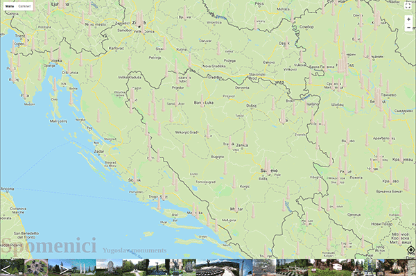

# Spomeniks

Yugoslav monuments travel app.

Visit: [mudroljub.github.io/spomeniks](https://mudroljub.github.io/spomeniks/)

[](https://mudroljub.github.io/spomeniks/)

## Development

```
live-server
```

## Data sources

Slovenian memorials: [Register nepremične kulturne dediščine](https://podatki.gov.si/dataset/register-nepremicne-kulturne-dediscine), Ministrstvo za kulturo RS, CC BY 4.0.

## TODO

- mapirati spomenike iz `data/bez_lokacije.json` (poznati, ali bez tačne lokacije)
- iz nekih slika na wiki commons se može izvući lokacija manje poznatih spomenika
- dragocen resurs za podatke o skulpturama i autorima: https://skulptura-hronologijaizlaganja.rs/ temeljno pretraži, požanji i izvuci sve korisne podatke. posebno pogledaj https://skulptura-hronologijaizlaganja.rs/mapa-spomenika/
- možda uvesti novi tip za skulpture ljudi? razlozi za i protiv
- bilo bi korisno mapirati istorijske ličnosti (i vojne jedinice, događaje i sl.) za svoje spomenike. za početak dodati polje kome ili čemu je spomenik posvećen u info prozor?
- spomenicinob.info: popis svih spomenika NOB u BiH po opštinama (naziv, mesto, vrsta, godina, autor, da li postoji; bez koordinata), oko 140 stranica sporog preuzimanja; dogovoriti pre početka